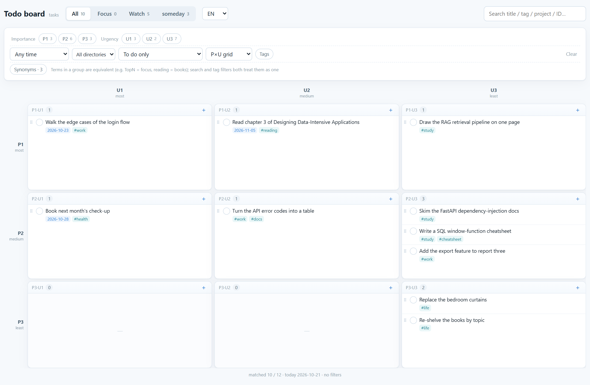
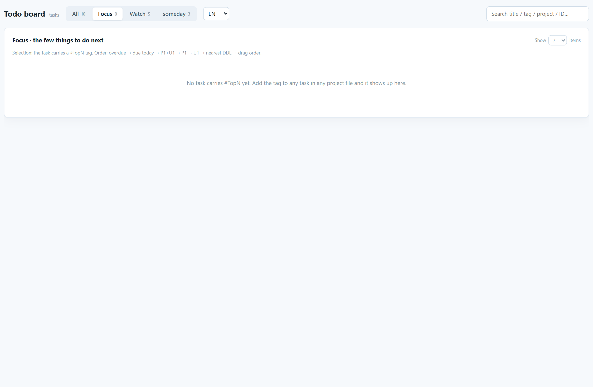
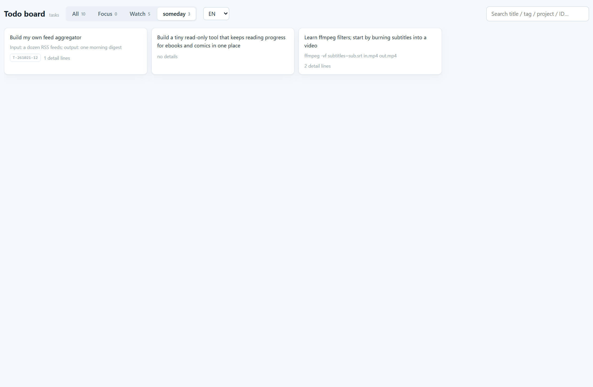

# Quadrant

**A markdown-first todo system for humans and AI agents.**
One line per task, one file per project — no database, no account, no cloud lock-in.

[中文说明](README.zh-CN.md) · [Design notes](docs/design.md) · [Agent skill](skill/quadrant/SKILL.md)

<p align="center">
  
</p>

Your todos are a pile of `.md` files. Edit them in Obsidian, VSCode, vim or on your
phone; or just tell an AI agent "turn the API error codes into a table before Friday"
and let it write the right line. The built-in board is optional cosmetics — **without
it, `grep` and an editor still work**.

## Why another todo app?

| | Notion / Todoist | Obsidian plugins | **Quadrant** |
| --- | --- | --- | --- |
| Where the data lives | someone else's server | local markdown | **local markdown (single source of truth)** |
| Offline | ✗ | ✓ | ✓ |
| `git log` your decisions | ✗ | half | ✓ |
| An AI agent can read/write it safely | ✗ API + OAuth | ✗ bespoke format | **✓ it is one line of text** |
| Drag ordering | ✓ | depends | ✓ (order kept aside, never pollutes markdown) |
| Priority / quadrants | ✓ | varies | **P×U grid, encoded as `#P1 #U2`** |

Three ideas hold it together:

1. **Capture is free** — unclear things go to `0-inbox.md`, one line each, unsorted.
2. **Priority is a field, not a position** — changing it edits one character
   (`#P2` → `#P1`) instead of moving paragraphs.
3. **The agent touches only the line that changed** — line order, indented details and
   newline style are untouched, so humans and agents can edit the same files.

## Quick start

```bash
git clone https://github.com/chillrain666/quadrant-md.git
cd quadrant-md
python scripts/init_tasks.py          # creates tasks/ (directories + demo data)
cd app
uv sync                               # or: pip install -r requirements.txt
uv run python main.py                 # -> http://127.0.0.1:8000 (steps to a free port if busy)
```

If the grid appears, you are done. The frontend build ships with the repo, **no Node
required**.

Point it at an existing notes directory instead:

```bash
TASKS_ROOT=/path/to/my/tasks uv run python main.py        # macOS / Linux
set TASKS_ROOT=D:\notes\tasks && uv run python main.py    # Windows
```

## The directory *is* the database

```
tasks/
├── 0-inbox.md       capture box: anything not thought through (never on the board)
├── 1-active/        in progress, one file per project      <- the only board source
│   ├── study/study.md
│   └── life/chores/chores.md
├── 2-notes/         long details (not scanned)
├── 3-log/           timeline log, append only (not scanned)
├── 4-someday.md     "one day" items + ideas (own panel)
├── 5-archive/       finished projects (not scanned)
└── follow/          lists: shows, books, serials (own panel, no P/U)
```

Four tracks, each with its own surface: tasks reach the quadrants, lists do not, ideas go
to someday, and captured items are shown **nowhere**. That last one is deliberate — once
captured items are visible, people start tidying them, which defeats capture.

## What one task looks like

```markdown
- [ ] T-261021-1 Read chapter 3 of DDIA #P1 #U2 #reading DDL:2026-11-05
      indented lines are details of this task, kept verbatim, deleted with it
```

| Piece | Meaning |
| --- | --- |
| `- [ ]` `- [x]` `- [-]` | to do / done / blocked |
| `T-261021-1` | globally unique ID: `T-` + `YYMMDD` + `-` + daily sequence, immutable |
| `#P1`~`#P3` | importance, P1 highest |
| `#U1`~`#U3` | urgency, U1 highest |
| `#tag` | several allowed, CJK / capitals / `a/b` all fine |
| `DDL:2026-11-05` | due date |
| `DONE:2026-10-21` | completion date (stamped when you tick) |

**Quadrants are computed from `P × U`, never stored**, so changing priority is a
two-character edit. The board draws a 3×3 grid (one row per P, one column per U) because
each axis has three levels; forcing that into four cells throws information away.

## Built for AI agents

`skill/quadrant/` is an agent skill in the `SKILL.md` shape used by Claude Agent Skills,
pi, Cursor and friends. Drop it into your agent's skills directory and it knows:

- which file a sentence belongs to ("note this" → inbox, "this week" → active,
  "someday" → someday, "started following X" → follow)
- how to write without damaging the file (append only, edit one line, per-file newline
  style, compute the ID)
- how to run the board and how to do a weekly review

A conversation looks like this:

> **You:** note that I want to try a two-week review cycle
> **Agent:** wrote to `tasks/0-inbox.md`: `- Try a two-week review cycle`

> **You:** turn the API error codes into a table before Friday, it matters
> **Agent:** wrote to `tasks/1-active/work/demo-project.md`:
> `- [ ] T-261021-18 Turn the API error codes into a table #P2 #U1 #work DDL:2026-10-23`

> **You:** done with that one
> **Agent:** `- [x] ... DONE:2026-10-23` (two spots changed)

Install for pi:

```bash
cp -r skill/quadrant ~/.pi/agent/skills/
```

For Claude Code or any other client that supports skills, copy `skill/quadrant/` into its
skills directory. Clients without skills support can still use `SKILL.md` as a rules file.

## Board features

### Find

- **One search box, everything**: title, detail lines, tags, file name / directory and
  task ID. Case-insensitive, `#reading` is the same as `reading`, and the synonym table
  expands terms (`TopN` = `focus`, `reading` = `books`).
- **Search inside every panel**: the same box filters the board, Focus, Following and
  someday.
- **Filters**: independent P and U axes, due window (any time / overdue / today / this
  week / this month / no DDL), status, cascading directory picker, tags with counts.
- **Grouping**: the P×U grid, or grouped by project file.

### Move

- **Tick it off**: click the circle to complete (stamps `DONE:`); click again to reopen.
- **Drag to reorder** inside a cell or a panel; the order sticks.
- **Drag across cells to change the quadrant**: dropping a task on another P×U cell
  rewrites `#P` / `#U` for you.
- **Drag onto a tab**: dropping on **Focus** adds `#TopN`; dropping on **someday** moves
  the whole task (line + detail lines) into `4-someday.md`.
- **Someday cards** drag in four directions to reorder.

### Edit

- **Click a task** for a compact dialog: title, importance, urgency, status
  (todo / done / blocked), DDL, tags and detail lines — plus the raw line and
  `file:line · ID` for when something looks off.
- **Detail lines are the file**: the indented Markdown block under the task is edited
  inline and written straight back (blank lines dropped, two-space indent restored).
- **Keyboard**: Enter saves, Esc closes, deleting asks once.
- **Hand-written tasks** get an ID on the first edit (located by file + line + raw text),
  so anything you typed by hand becomes editable like the rest.
- **Duplicate IDs** are reported and repaired in one click; lines that look like tasks
  but fail the parser (a missing space after `- [ ]`) show up in a banner instead of
  disappearing.

### See

- **File chip**: every row starts with the name of the file it lives in, so you can tell
  projects apart at a glance.
- **Focus sorts itself**: overdue → due today → P1U1 → P1 → U1 → nearest DDL → your own
  drag order.
- **Language switch**: English / 中文, remembered per browser.

<p align="center">
  
  
</p>

Drag order is **never written into markdown**: the board keeps one global order in
`app/.order.json`, and the secondary panels keep per-panel lists in `app/.lists.json`.
Both are derived state — delete them and the default order returns.

## The lineage (what this borrows, honestly)

This is not a new idea so much as a careful recombination of well-known ones:

- **Importance × urgency** comes from the **Eisenhower Matrix** — attributed to Dwight D.
  Eisenhower's "what is important is seldom urgent" remark, and popularised for ordinary
  people by **Stephen R. Covey** in *The 7 Habits of Highly Effective People* (1989).
  Quadrant nudges it from 2×2 to **3×3**, because a two-level axis forces you to lie about
  "medium".
- **The capture inbox, the "someday/maybe" list and the weekly review** are the three
  habits that make **David Allen's _Getting Things Done_** (2001) work. This system takes
  exactly those three and drops the rest.
- **One line per task, greppable, plain text** follows the **todo.txt** convention
  (Gina Trapani, 2007) and the wider local-first / plain-text movement around
  **Obsidian** — files over databases, `git` over sync services.
- **Agent-native packaging** follows **Anthropic's Agent Skills** (`SKILL.md`): the
  operating manual ships next to the data, so any agent can pick it up.
- The first draft of the markdown contract was written with **Doubao** (ByteDance's
  assistant) in October 2026, then reshaped over two weeks of daily use: the 3×3 grid,
  the three tracks, the global total order and the "touch one line" write-back rules all
  came from things that broke in practice.

If you are here from the productivity side: the interesting part is not the grid, it is
that **the file is the API**.

## Code layout

```
app/          FastAPI backend + React frontend (no third-party UI or drag library)
  parser.py     read-only: scan, parse, filter, group, Focus ordering
  writer.py     write-back: touch one line, re-parse and verify, restore on mismatch
  order.py      board order: one global total order, stored in .order.json
  lists.py      panel order: per-scope lists in .lists.json
  synonyms.py   synonym table shared by search, tag filters and Focus
  web/          React 19 + TS + Vite (already built into dist/)
skill/quadrant/ agent skill: SKILL.md + references (grammar, layout, recipes, panel, review)
templates/tasks/ the data-directory template copied by init_tasks.py
scripts/      init_tasks.py, screenshot.mjs
```

## Tests

```bash
cd app && uv run python run_tests.py    # 100+ assertions, all in temp directories
```

## Design trade-offs (on purpose)

- **Order is not in markdown**: writing it there means reordering files on every drag,
  huge diffs, and a fight between "human edits the md" and "the board drags".
- **Grouping ≠ filtering**: due buckets are mutually exclusive; the `due=week` filter is a
  rolling seven days including today.
- **The date in the ID is the creation date**: no collisions across years and no "what
  number am I on" bookkeeping.
- **No cloud sync**: the data is your files, sync them with git / Syncthing / iCloud.

## Roadmap

- [ ] Savable multi-filter views
- [ ] Indexing / caching beyond a few thousand tasks

## License

MIT
